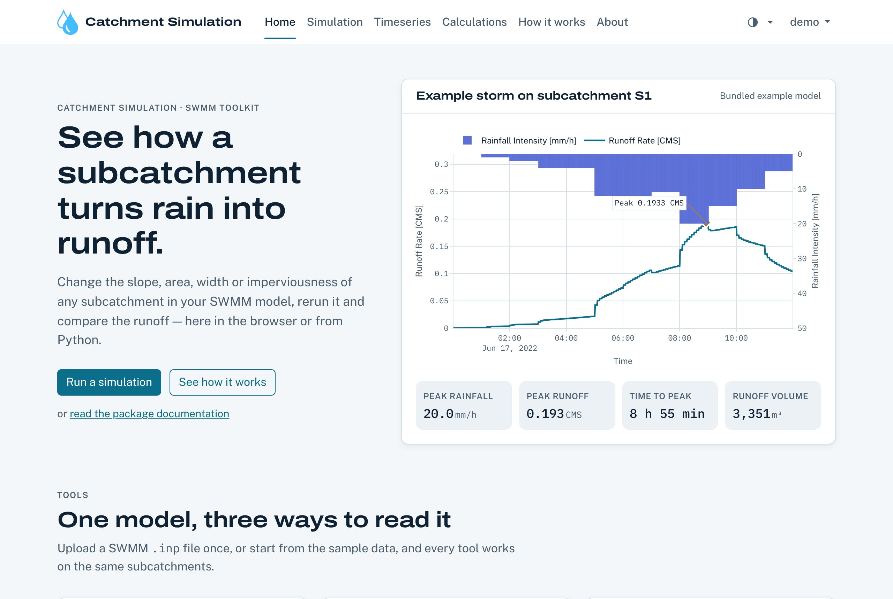
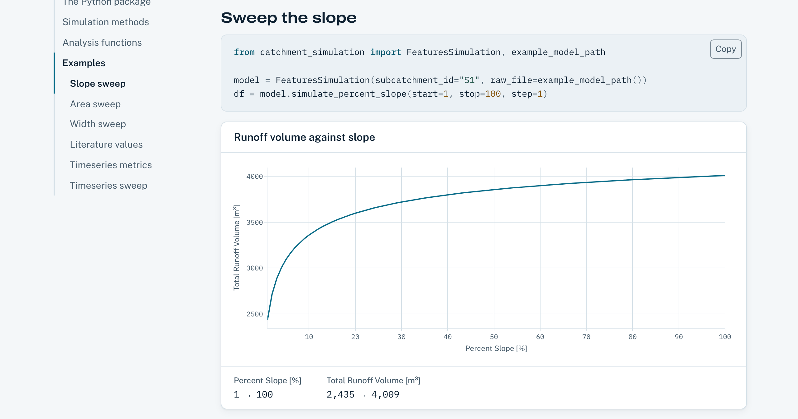
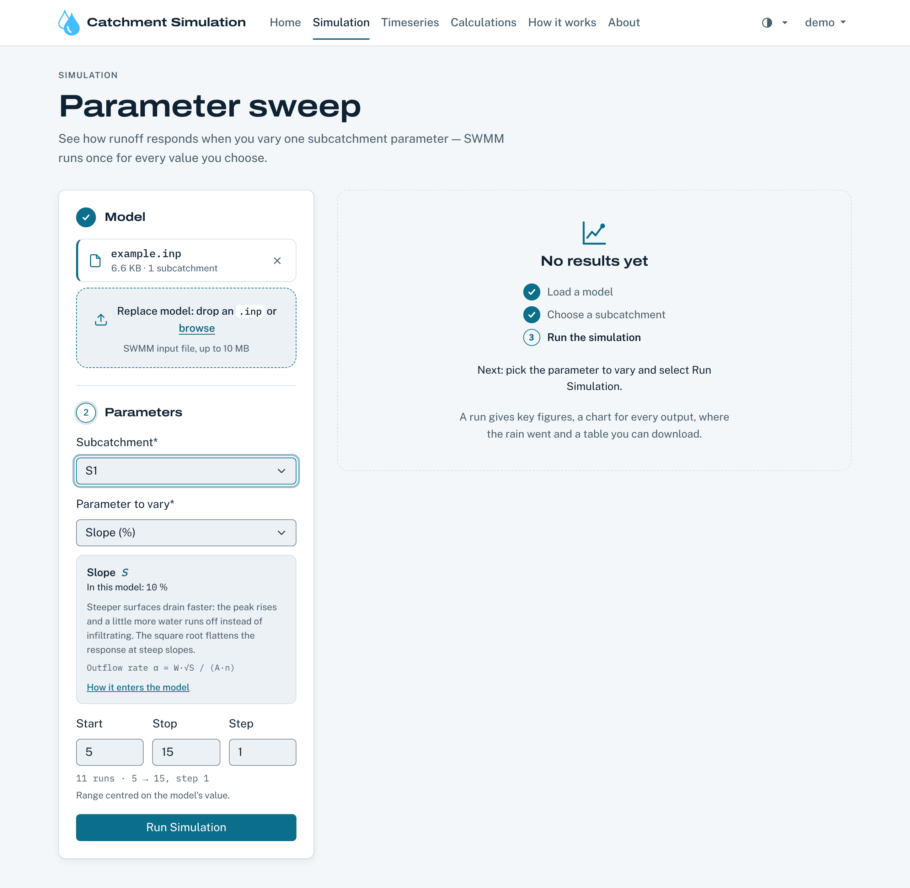
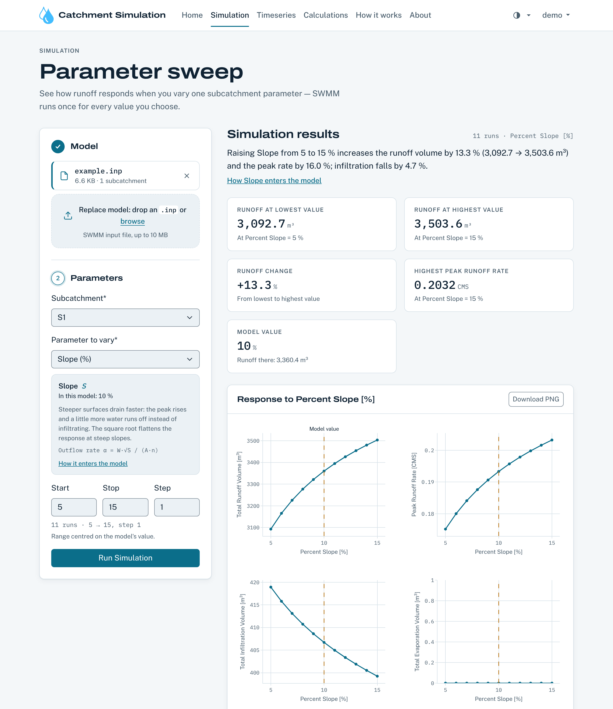
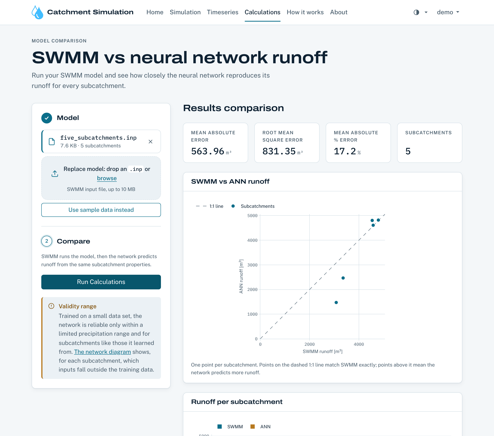
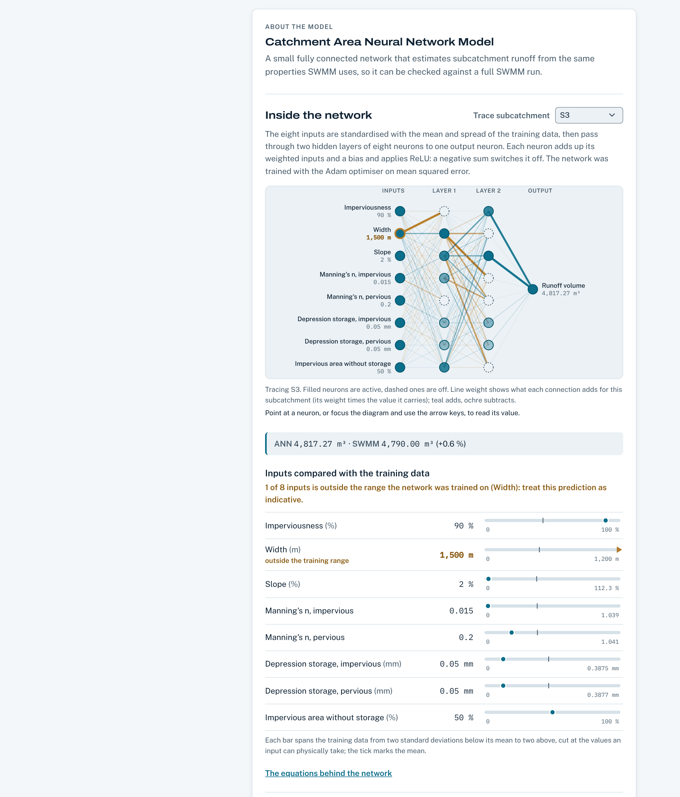
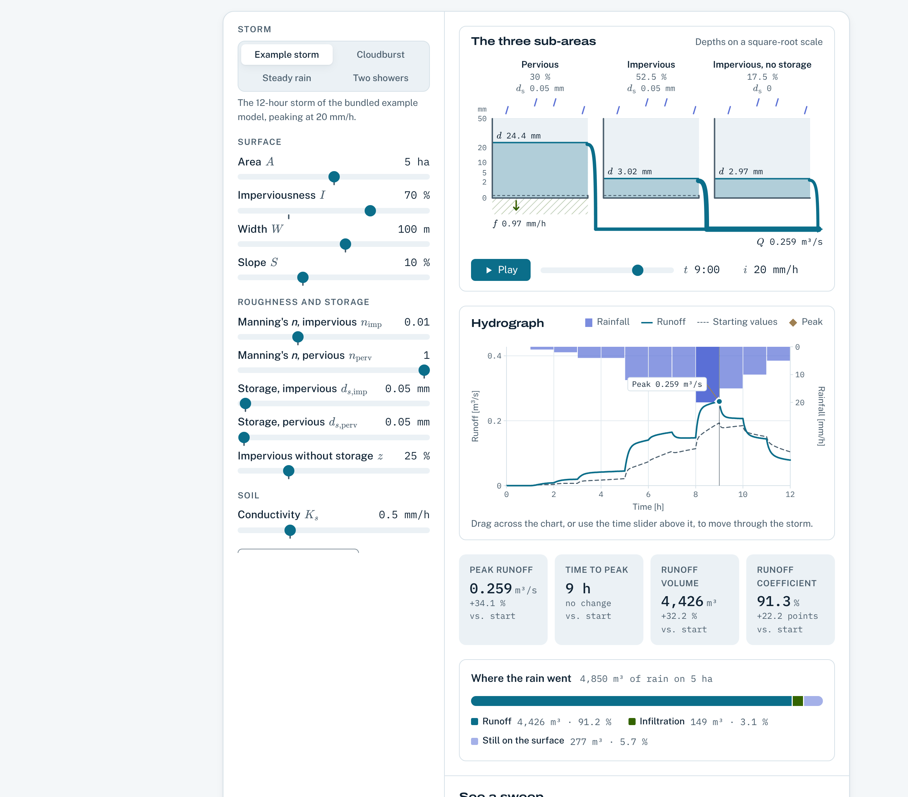

# Catchment Simulation web application

[](https://github.com/BuczynskiRafal/catchments_simulation/actions/workflows/django.yml)

A Django application built on the
[`catchment-simulation`](../README.md) package. It lets you upload a SWMM
model, run subcatchment feature sweeps in the browser, plot and download the
results, and compare SWMM runoff with a neural-network prediction.

Live instance: <https://catchment-simulations.onrender.com/>

The application lives in this repository only; it is not part of the PyPI
package. Its dependencies are the `web` dependency group of the root
`pyproject.toml`.

<div align="center">
    
    
</div>

## Features

Every tool works on one SWMM model per session: upload an `.inp` file or load
the bundled sample. The pages lead from the model to the result: a model with
a single subcatchment selects it, the chosen parameter is explained and shown
with its value in the model, a sweep range around that value is suggested, and
a status panel reports the run.

### Simulations

The *Simulation* page sweeps one subcatchment parameter: SWMM runs once for
every value. The results show the key figures and a sentence that reads them,
a chart of every output with the model's own value marked, where the rain of
each run went (runoff, infiltration, evaporation, water left on the surface),
a sortable table and an Excel download.

<div align="center">
    
    
</div>

### Timeseries

The *Timeseries* page plots rainfall against runoff for one run, with the peak,
the time to peak and the runoff volume, or overlays the hydrographs of a
parameter sweep. Results download as Excel or CSV.

### Calculations: SWMM and ANN

The *Calculations* page runs the model in SWMM and predicts the runoff of
every subcatchment with a small neural network, then compares both. The
network is drawn from its weights: tracing a subcatchment shows which neurons
fire and what each connection contributes, and marks the inputs that lie
outside the data the network was trained on.

<div align="center">
    
    
</div>

You need to register and log in before running simulations or calculations.

### How it works

The public *How it works* page explains the model behind the numbers: the
nonlinear reservoir equation SWMM solves for a subcatchment, Green–Ampt
infiltration, the numerical solution, what a sweep measures and how the neural
network computes its estimate. Its interactive model solves the same equations
in the browser (`main/static/main/js/model/runoff-model.js`): move a slider and
the three sub-area reservoirs, the hydrograph and the water balance respond.
The end-to-end suite checks that model against the SWMM engine; on the example
model the runoff volume, the peak rate and the infiltration agree within 0.1 %.

<div align="center">
    
</div>

### Model and static data artifacts

- The ANN weights are loaded from `cs_app/swmm_model/weights.npz` (pure NumPy
  inference). They are preloaded at start-up by `main.apps.MainConfig.ready()`
  and reused from a module-level predictor cache.
- Static chart seed data in `cs_app/data` is stored as JSON files (`*.json`).
- Simulation and timeseries downloads are generated in memory on demand; no
  media files are persisted.

### JSON REST API

Authenticated users can also interact with the application programmatically via
JSON endpoints under `/api/`:

| Endpoint               | Methods       | Description                                                            |
|------------------------|---------------|------------------------------------------------------------------------|
| `/api/status/`         | `GET`         | Current session model metadata, flow units, subcatchments, and labels  |
| `/api/upload/`         | `POST`        | Upload a `.inp` model (`multipart/form-data`)                          |
| `/api/upload/sample/`  | `POST`        | Load the bundled `example.inp` model into the session                  |
| `/api/upload/clear/`   | `POST`        | Clear the session model and cached results                             |
| `/api/subcatchments/`  | `GET`         | List subcatchment IDs, flow units, and unit-aware parameter labels     |
| `/api/simulation/`     | `GET`, `POST` | Retrieve the latest parameter sweep or run a new sweep (`JSON` / form) |
| `/api/timeseries/`     | `GET`, `POST` | Retrieve the latest timeseries analysis or run a new one               |
| `/api/calculations/`   | `GET`, `POST` | Retrieve or run the SWMM vs. ANN runoff comparison                     |

## Local development

### Prerequisites

- Python 3.10 or newer
- [uv](https://docs.astral.sh/uv/)

### Installation

```bash
git clone https://github.com/BuczynskiRafal/catchments_simulation.git
cd catchments_simulation

# dev tools (default group) + the Django app
uv sync --frozen --group web
```

`uv sync` installs exactly the groups you name (plus `dev`, the default), and
removes the others, so combine them in one command when you need several:

| Task                         | Command                                          |
|------------------------------|--------------------------------------------------|
| App development and tests    | `uv sync --frozen --group web`                   |
| Playwright end-to-end tests  | `uv sync --frozen --group web --group e2e`       |
| Building the documentation   | `uv sync --frozen --group docs --group web`      |

#### macOS: processes killed with SIGKILL

On macOS, `import pyswmm` can be killed (exit code 137) because some
libraries in the `swmm-toolkit` wheel carry invalid code signatures. Re-sign
them ad hoc in the virtual environment:

```bash
codesign --force --sign - .venv/lib/python3.*/site-packages/swmm/toolkit/*.dylib
```

### Configuration

Settings are read from environment variables, and from `cs_app/.env` if it
exists. In production (`DEBUG=False`), `SECRET_KEY` and `DATABASE_URL` are
strictly required; in local development (`DEBUG=True`), safe development
fallbacks (`sqlite:///db.sqlite3`) are used if omitted. Start from the example:

```bash
cp cs_app/.env.example cs_app/.env
```

### Running the application

```bash
cd cs_app
uv run python manage.py migrate
uv run python manage.py createsuperuser   # optional, for the admin site
uv run python manage.py runserver
```

Open <http://127.0.0.1:8000/>.

### Tests

The Django tests use `cs_app.test_settings` (set in `cs_app/pytest.ini`):

```bash
cd cs_app
uv run pytest main register
```

### End-to-end tests (Playwright)

The Playwright tests are marked `e2e` and excluded from the default run, so
they are selected explicitly:

```bash
# from the repository root
uv sync --frozen --group web --group e2e
uv run playwright install chromium
uv run pytest cs_app/e2e -m e2e --browser chromium
```

## Docker

The image is built from the repository root, because it installs the
`catchment-simulation` package from `src/` together with the `web` group:

```bash
docker build -f cs_app/Dockerfile -t catchment-simulations .
```

The CI workflow `django.yml` builds and smoke-tests this image on every push.
The container serves the app as a non-root user with gunicorn on port 8000 and
exposes a readiness probe at `/healthz/`. `cs_app/docker-compose.yml` provides
a multi-container setup with PostgreSQL.

## Deployment (Render)

`cs_app/render.yaml` describes the Render Blueprint: a Docker web service built
from `cs_app/Dockerfile` (using the repository root context) with a health
check on `/healthz/`, and a managed PostgreSQL database. `cs_app/build.sh` is
the native (non-Docker) build script using `uv`: it installs the `web` group,
collects static files, and applies migrations.

For production, make sure that:

- `DATABASE_URL` points to PostgreSQL (`psycopg2-binary` is in the `web` group),
- `DEBUG=False`,
- `SECRET_KEY` is a proper secret,
- upload limits agree across layers: the Django limits
  (`INP_UPLOAD_MAX_BYTES`, `INP_UPLOAD_MAX_BODY_BYTES`) are defined in
  settings, and the reverse proxy's request-body limit should be greater than
  or equal to `INP_UPLOAD_MAX_BODY_BYTES`.

Example Nginx setting:

```nginx
client_max_body_size 11m;
```

Proxy-level limits are the first line of defence; Django limits are the second.

Threat model notes:

- Upload size limits and streamed chunk validation run before CSRF/multipart
  body parsing, protecting the Django workers' memory against oversized or
  spoofed `Content-Length` requests.
- Uploaded `.inp` files are scanned for external file directives (`[FILES]`,
  `[BACKDROP]`, `FILE` references in `[TIMESERIES]`, `[RAINGAGES]`,
  `[TEMPERATURE]`, `[EVAPORATION]`, and `[LID_USAGE]`) before saving, and SWMM
  executions run in isolated temporary directories.
- Disk and CPU pressure from many concurrent large uploads still needs
  infrastructure controls (proxy limits, rate limiting, worker sizing).

## Project structure

```text
cs_app/
├── cs_app/           # Django project: settings, test settings, URLs, WSGI
├── main/             # main application (simulations, calculations, ANN)
├── register/         # user registration
├── e2e/              # Playwright end-to-end tests
├── static/           # shared images (logo)
├── data/             # static chart data in JSON format
├── swmm_model/       # ANN runtime artifact (weights.npz)
└── manage.py
```

- Domain-level simulation validation schemas live in
  `src/catchment_simulation/schemas.py`.
- Web-only payload schemas (for example the contact form) live in
  `cs_app/main/schemas.py`.
- What the pages tell the user about a model (values of a subcatchment, range
  suggestions, the water balance of a sweep) is computed in
  `cs_app/main/insights.py`; the description of every sweepable parameter is
  in `cs_app/main/guide.py`.
- The front end has no build step: templates in `main/templates/`, plain
  scripts and styles in `main/static/main/`. Its design system and interaction
  contracts are documented in
  [`docs/design/design-system.md`](../docs/design/design-system.md).
